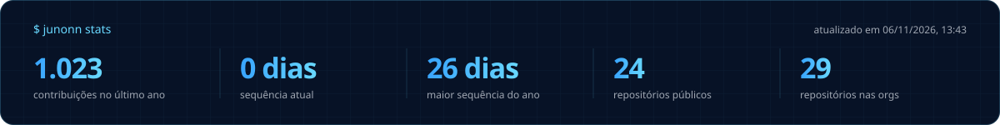
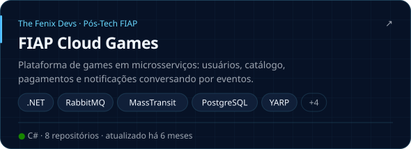
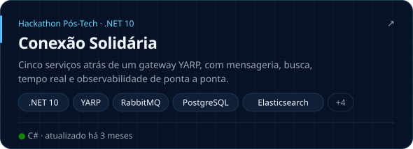
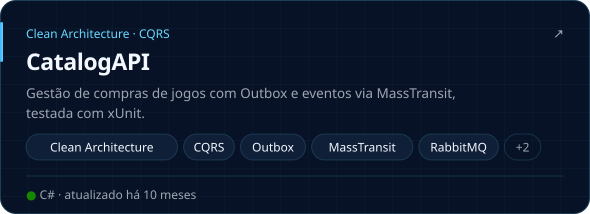
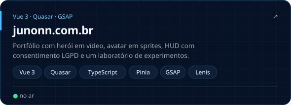
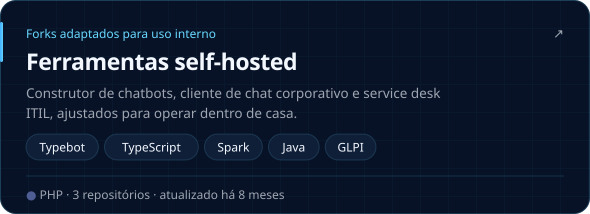
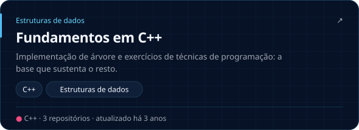

<a href="https://junonn.com.br">
  
</a>

<p align="center">
  <a href="https://junonn.com.br"></a>
  <a href="https://www.linkedin.com/in/junonnfernando-dev"></a>
  <a href="https://www.behance.net/fejunior5"></a>
  <a href="https://tinyurl.com/junonn"></a>
</p>

```console
$ junonn whoami
nome      Fernando Gomes de Sousa Júnior
papel     Desenvolvedor Full Stack sênior · Junonn Tecnologia
base      Goiânia - GO
entrego   software sob medida, automação e IA aplicada
foco      .NET + Vue 3, com o domínio no centro e a tecnologia na borda
```



### `ls ~/projetos`

<!-- junonn:projects:start -->
<p align="center">
<a href="https://github.com/fenixdevsreborn/Fase4-FCG-Orchestrator"></a>
<a href="https://github.com/fenixdevsreborn/Fase5-Hackathon"></a>
<a href="https://github.com/fejunior/fase2-CatalogAPI"></a>
<a href="https://junonn.com.br"></a>
<a href="https://github.com/fejunior/junonn.typebot.io"></a>
<a href="https://github.com/fejunior/Arvore-em-C-plus-plus"></a>
</p>
<!-- junonn:projects:end -->

### `junonn orgs`

<!-- junonn:orgs:start -->
<table><tr>
<td align="center" width="33%">
<a href="https://github.com/fenixdevsreborn"></a><br/>
<b>The Fenix Devs</b><br/>
<sub><code>Owner</code> · 19 repos públicos</sub><br/>
<sub>Microsserviços .NET da Pós-Tech FIAP (fases 3 a 5)</sub>
</td>
<td align="center" width="33%">
<a href="https://github.com/thefenixdevs"></a><br/>
<b>thefenixdevs</b><br/>
<sub><code>Membro</code> · 10 repos públicos</sub><br/>
<sub>Tech Challenge FIAP Cloud Games (fase 2)</sub>
</td>
<td align="center" width="33%">
<a href="https://github.com/Foguete-4RI"></a><br/>
<b>TIC 4 RIGO</b><br/>
<sub><code>Owner</code> · nenhum repo público ainda</sub>
</td>
</tr></table>
<!-- junonn:orgs:end -->





### `git log --oneline principios`

```diff
+ a1f9c3e feat:     clareza antes de esperteza
! 7c2e0b4 refactor: regra de negócio longe do framework
- e4a7f10 fix:      falhar alto e com contexto
+ 3e8d21a test:     confiança vem de teste, não de coragem
! 9b04f7d perf:     medir antes de otimizar
# 5d61ac2 docs:     o próximo dev é você daqui a seis meses
```

### `junonn log --recent`

<!-- junonn:recent:start -->
| repositório | linguagem | quando |
|---|---|---|
| [`fenixdevsreborn/Fase5-Hackathon`](https://github.com/fenixdevsreborn/Fase5-Hackathon) | C# | há 4 meses |
| [`fenixdevsreborn/Fase4-UsersAPI`](https://github.com/fenixdevsreborn/Fase4-UsersAPI) | C# | há 6 meses |
| [`fenixdevsreborn/Fase4-Orchestrator`](https://github.com/fenixdevsreborn/Fase4-Orchestrator) | PowerShell | há 6 meses |
| [`fenixdevsreborn/Fase4-PaymentsAPI`](https://github.com/fenixdevsreborn/Fase4-PaymentsAPI) | C# | há 6 meses |
| [`fenixdevsreborn/Fase4-NotificationAPI`](https://github.com/fenixdevsreborn/Fase4-NotificationAPI) | C# | há 6 meses |
| [`fenixdevsreborn/Fase4-GamesAPI`](https://github.com/fenixdevsreborn/Fase4-GamesAPI) | C# | há 6 meses |
<!-- junonn:recent:end -->

<picture>
  <source media="(prefers-color-scheme: dark)" srcset="https://raw.githubusercontent.com/fejunior/fejunior/output/snake-dark.svg" />
  <source media="(prefers-color-scheme: light)" srcset="https://raw.githubusercontent.com/fejunior/fejunior/output/snake-light.svg" />
  
</picture>

<p align="right"><sub><code>build concluído · este perfil se atualiza sozinho todo dia ▸</code></sub></p>
